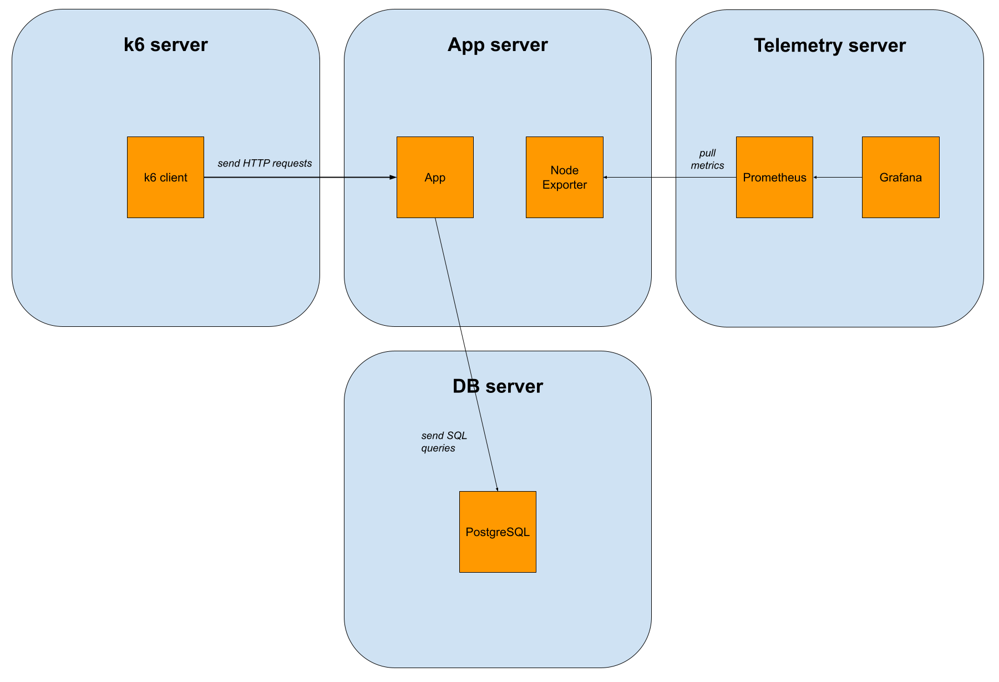
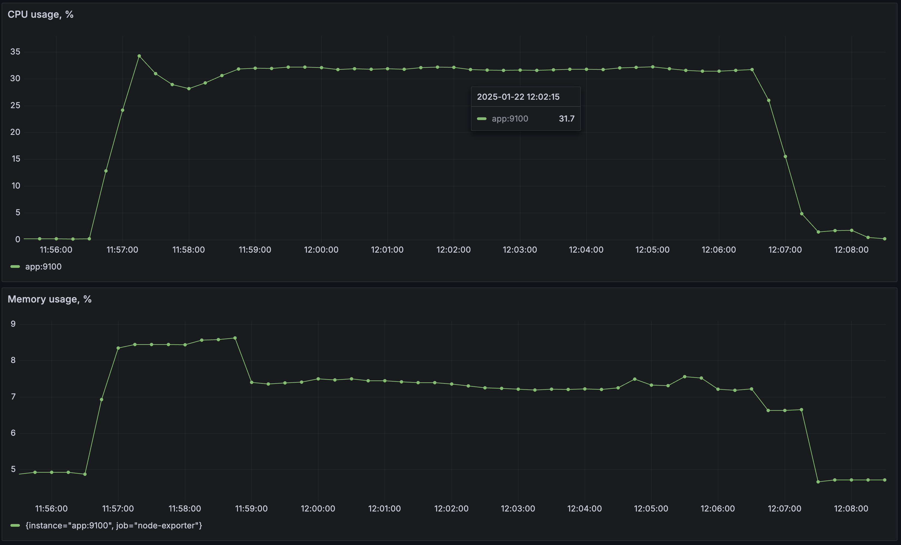
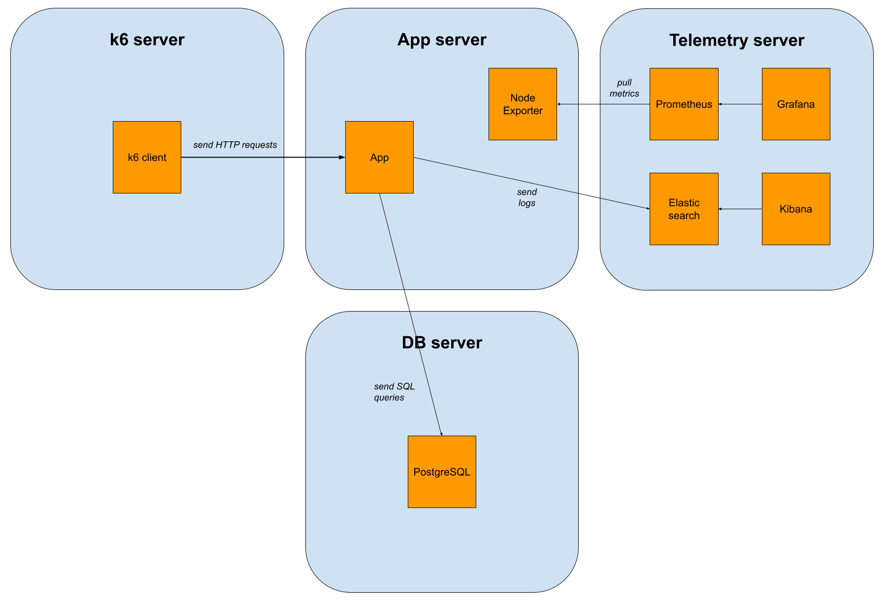
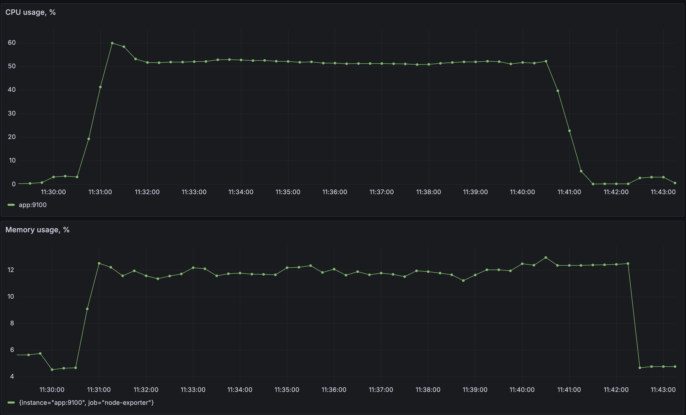
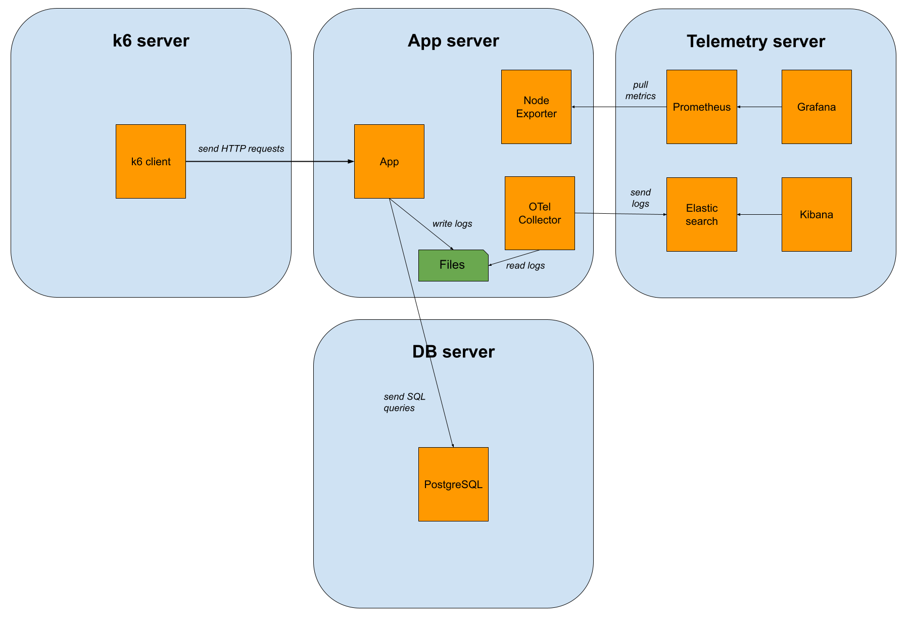
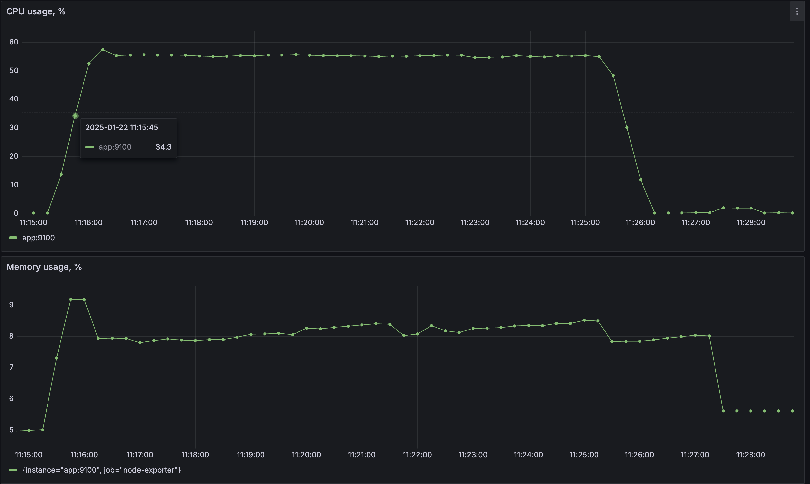

# Logging Benchmarks

## Goal

The primary goal of this experiment is to __evaluate the performance implications of centralized logging__ in an ASP.NET Core application under high load. In many production environments, __centralized logging__ is essential, and Elasticsearch is a popular choice for log storage and analysis. Two frequently adopted approaches are:

1. __Direct Logging to Elasticsearch__ - https://www.elastic.co/guide/en/ecs-logging/dotnet/current/extensions-logging-data-shipper.html.
2. __Logging via the OpenTelemetry Collector, which handles reading, buffering, and forwarding logs to Elasticsearch__ - https://opentelemetry.io/docs/specs/otel/logs/.

By comparing these options (including a baseline with no logging at all), we aim to gather performance data (CPU, memory, and latencies) to help inform better architectural decisions regarding log processing pipelines.

## Setup

The application to be tested is located at https://github.com/drim-dev/logging-benchmarks/tree/main/backend.

It contains several endpoints. We will test the single POST endpoint that inserts a record into PostgreSQL and writes two log records. One record is written explicitly, while Entity Framework Core writes the other. https://github.com/drim-dev/logging-benchmarks/blob/main/backend/LoggingBenchmark.WebApp/Features/Projects/Requests/CreateProject.cs.

We use k6 to generate load. The default configuration sends 2000 requests per second for 10 minutes - https://github.com/drim-dev/logging-benchmarks/blob/main/k6/script.js. We use the open model. Read the article for details - https://grafana.com/docs/k6/latest/using-k6/scenarios/concepts/open-vs-closed/.

Node Exporter gathers app server metrics, which Prometheus pulls and stores. Grafana allows us to see metrics graphs. We are interested in two metrics:

* App server CPU utilization https://github.com/drim-dev/logging-benchmarks/blob/main/terraform/modules/grafana-stack/dashboards/server-utilization.json#L111

* App server memory utilization https://github.com/drim-dev/logging-benchmarks/blob/main/terraform/modules/grafana-stack/dashboards/server-utilization.json#L203

We use Elasticsearch for log storage and Kibana for log visualization.

The testing environment consists of 4 Azure virtual machines. The VM size is Standard_D4ads_v5, and it contains 4 vCPUs and 16 GB of RAM - https://github.com/drim-dev/logging-benchmarks/blob/main/terraform/modules/azure/virtual-machine/main.tf#L41.

_We use several servers to isolate components so they do not interfere with each other and distort the benchmark results._

## Benchmarks

We ran all benchmarks several times to ensure the results were stable and reproducible.

### No Logging

The application has logging disabled. We do not run OpenTelemetry Collector.

#### App Server Utilization

_CPU utilization is ~32%._

_Memory utilization is ~7.3%._

#### HTTP Requests Latencies

 avg      | min      | med      | p(90)    | p(95)    |  max
----------|----------|----------|----------|----------|----------
 13.17 ms | 1.67 ms  | 3.02 ms  | 7.89 ms  | 18.67 ms | 1.24 s

### Application to Elasticsearch

The application sends logs directly to Elasticsearch. We do not run OpenTelemetry Collector.

#### App Server Utilization

_CPU utilization is ~52%._

_Memory utilization is ~12%._

#### HTTP Requests Latencies

 avg      | min      | med      | p(90)    | p(95)    |  max
----------|----------|----------|----------|----------|----------
 11.27 ms | 1.74 ms  | 3.16 ms  | 8.77 ms  | 32.39 ms | 1.56 s

### OpenTelemetry Collector to Elasticsearch

The application writes logs in JSON format to the console. Docker writes logs from the console to a JSON file. We run OpenTelemetry Collector, which reads logs from the JSON file and sends them to Elasticsearch.

#### App Server Utilization

_CPU utilization is ~55%._

_Memory utilization is ~8.5%._

#### HTTP Requests Latencies

 avg      | min      | med      | p(90)    | p(95)    |  max
----------|----------|----------|----------|----------|----------
 9.42 ms  | 1.71 ms  | 3.11 ms  | 6.14 ms  | 8.89 ms  | 1.18 s

### Summary Table

 Scenario             | CPU      | Memory   | avg      | min      | med      | p(90)    | p(95)    |  max
----------------------|----------|----------|----------|----------|----------|----------|----------|----------
 No Logging           | 32%      | 7.3%     | 13.17 ms | 1.67 ms  | 3.02 ms  | 7.89 ms  | 18.67 ms | 1.24 s
 Application to ES    | 52%      | 12%      | 11.27 ms | 1.74 ms  | 3.16 ms  | 8.77 ms  | 32.39 ms | 1.56 s
 OTel Collector to ES | 55%      | 8.5%     | 9.42 ms  | 1.71 ms  | 3.11 ms  | 6.14 ms  | 8.89 ms  | 1.18 s

## Key Conclusions

1. __Logging incurs significant overhead__. Both logging scenarios (direct to Elasticsearch and via the Collector) drive CPU utilization up from 32% to ~50–55%. This is a 65-75% CPU consumption increase, which is huge. Memory consumption increase is also high.

2. __OTel Collector offers better performance than direct sending to Elasticsearch__. Despite a slightly higher CPU usage (55% compared to 52%), the OTel Collector solution consistently provides the lowest latencies across all metrics (average, tail, and max). The memory consumption is significantly lower (8.5% compared to 12%). This setup seems to offload work from the application process itself, leading to more stable and predictable response times.

## How to Reproduce

We use Terraform to setup environments.

### Local Environment

It is possible to run benchmarks on a local computer for debugging purposes. However, be aware that the results will be wrong because there will be no application isolation.

1. Make sure you have Docker, Terraform, and k6 installed
2. Clone the repository
3. cd into `terraform/environments/local`
4. Run `terraform init`
5. Run `terraform apply` and confirm the generated plan by typing `yes`
6. cd into `k6`
7. Use the `localhost` URL in the k6 script https://github.com/drim-dev/logging-benchmarks/blob/main/k6/script.js#L16
8. Run `k6 run script.js`
9. Go to Grafana `http://localhost:3000` (username and password are `admin`/`admin`) and select the "Server utilization" dashboard to see the metrics graphs
10. After k6 finishes, it outputs request latencies
11. Run `terraform destroy` to remove all components

For each benchmark type it is necessary to tweak the Terraform configuration:

1. No Logging
   * Make sure OTel Collector is commented out https://github.com/drim-dev/logging-benchmarks/blob/main/terraform/environments/local/main.tf#L31-L40
   * Make sure `benchmark_type = NoLogging` https://github.com/drim-dev/logging-benchmarks/blob/main/terraform/environments/local/main.tf#L72

2. Application to Elasticsearch
   * Make sure OTel Collector is commented out https://github.com/drim-dev/logging-benchmarks/blob/main/terraform/environments/local/main.tf#L31-L40
   * Make sure `benchmark_type = ElasticsearchHttpClient` https://github.com/drim-dev/logging-benchmarks/blob/main/terraform/environments/local/main.tf#L72

3. OpenTelemetry Collector to Elasticsearch
   * Make sure OTel Collector is not commented out https://github.com/drim-dev/logging-benchmarks/blob/main/terraform/environments/local/main.tf#L31-L40
   * Make sure `benchmark_type = JsonConsole` https://github.com/drim-dev/logging-benchmarks/blob/main/terraform/environments/local/main.tf#L72

### Azure Environment

1. Register at Azure, if not yet
2. Log in to Azure
3. Write down a Subscription ID from https://portal.azure.com/#view/Microsoft_Azure_Billing/SubscriptionsBladeV2
4. Install Azure CLI https://learn.microsoft.com/en-us/cli/azure/install-azure-cli
5. Login to Azure with CLI using `az login`
6. Clone the repository
7. cd into `terraform/environments/local`
8. Run `terraform init`
9. Run `terraform apply`
10. Enter the Azure Subscription ID
11. Enter a username to create in Azure VMs
12. Confirm the generated plan by typing `yes`
13. Save the SSH private key that is output at the end of the terraform operation
14. Go to the Azure VMs page to learn public IP addresses of the created servers https://portal.azure.com/#browse/Microsoft.Compute%2FVirtualMachines
15. Make sure you can SSH into each VM by using `ssh -i /path/to/saved/ssh/private/key <username>@<vm_public_ip>`

> __IMPORTANT!!!__
>
> Do not forget to locally cd into `terraform/environments/azure` and run `terraform destroy` to delete all Azure resources after finishing benchmarking. Your Azure bill will be big if you do not do this.

Now it is necessary to set up each VM separately.

1. db:

   * SSH into the db VM
   * Clone the repository and cd into its directory
   * Install Docker with `scripts/install-docker.sh`
   * Install Terraform with `scripts/install-terraform.sh`
   * cd into `terraform/environments/db-server` and run `terraform init` followed by `terraform apply`

2. telemetry:

   * SSH into the telemetry VM
   * Clone the repository and cd into its directory
   * Install Docker with `scripts/install-docker.sh`
   * Install Terraform with `scripts/install-terraform.sh`
   * cd into `terraform/environments/telemetry-server` and run `terraform init` followed by `terraform apply`
   * Go to Grafana at http://<telemetry_vm_public_ip>:3000, login using `admin`/`admin` and open the "Server utilization" dashboard to see the metrics graphs

3. app:

   * SSH into the app VM
   * Clone the repository and cd into its directory
   * Install Docker with `scripts/install-docker.sh`
   * Install Terraform with `scripts/install-terraform.sh`
   * cd into `terraform/environments/app-server` and run `terraform init` followed by `terraform apply`

4. k6:

   * SSH into the k6 VM
   * Clone the repository and cd into its directory
   * Install k6 with `scripts/install-k6.sh`
   * Run `k6 run k6/scripts.js` to run a benchmark
   * After k6 finishes, it outputs request latencies

For each benchmark type, the Terraform configuration must be tweaked before `terraform apply` at the app server:

1. No Logging
   * Make sure OTel Collector is commented out https://github.com/drim-dev/logging-benchmarks/blob/main/terraform/environments/app-server/main.tf#L21-L30
   * Make sure benchmark_type = NoLogging https://github.com/drim-dev/logging-benchmarks/blob/main/terraform/environments/app-server/main.tf#L40

2. Application to Elasticsearch
   * Make sure OTel Collector is commented out https://github.com/drim-dev/logging-benchmarks/blob/main/terraform/environments/app-server/main.tf#L21-L30
   * Make sure benchmark_type = ElasticsearchHttpClient https://github.com/drim-dev/logging-benchmarks/blob/main/terraform/environments/app-server/main.tf#L40

3. OpenTelemetry Collector to Elasticsearch
   * Make sure OTel Collector is not commented out https://github.com/drim-dev/logging-benchmarks/blob/main/terraform/environments/app-server/main.tf#L21-L30
   * Make sure benchmark_type = JsonConsole https://github.com/drim-dev/logging-benchmarks/blob/main/terraform/environments/app-server/main.tf#L40

> __IMPORTANT!!!__
>
> Do not forget to locally cd into `terraform/environments/azure` and run `terraform destroy` to delete all Azure resources after finishing benchmarking. Your Azure bill will be big if you do not do this.
